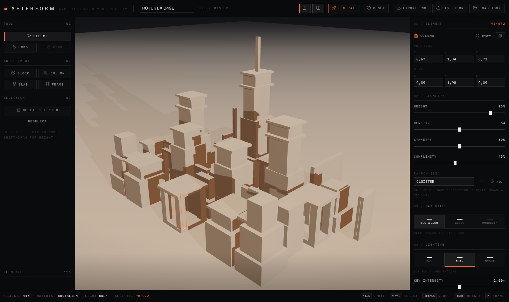
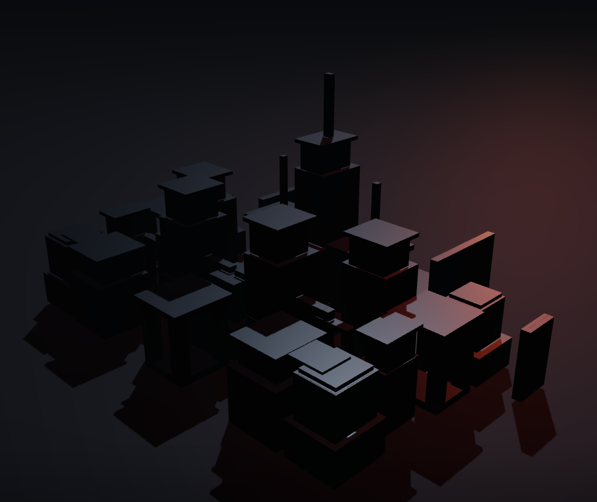
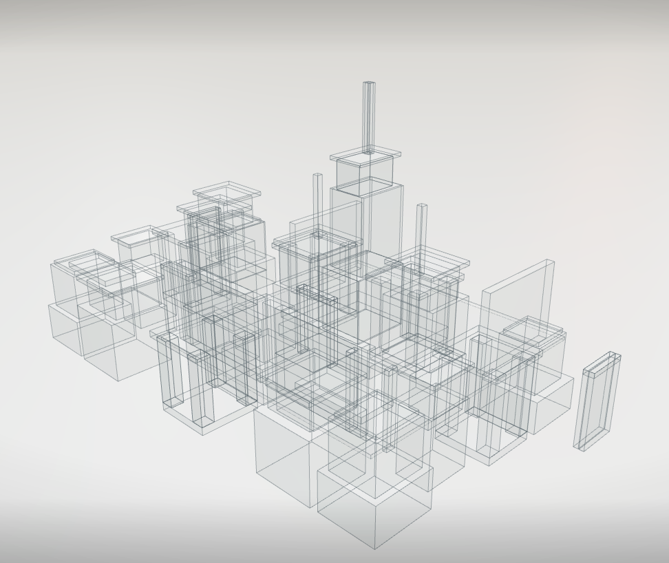
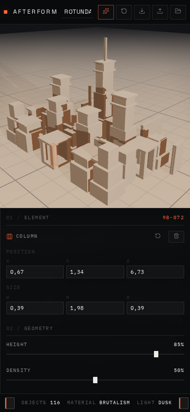

# AFTERFORM

**Architecture beyond reality.**

An interactive generative architecture laboratory. Set the parameters, draw a seed, and the studio
composes an abstract architectural study out of concrete, glass and stone — then lets you take it
apart and rebuild it by hand.



| Night / Monolith | Day / Glass | Phone |
| ---------------- | ----------- | ----- |
|  |  |  |

---

## Run it

```bash
npm install
npm run dev        # http://127.0.0.1:5174
```

| Script                | What it does                                                     |
| --------------------- | ---------------------------------------------------------------- |
| `npm run dev`         | Vite dev server                                                   |
| `npm run build`       | Type check + production build into `dist/`                        |
| `npm run preview`     | Serve the production build on `:4174`                             |
| `npm run typecheck`   | `tsc -b` over app, tests and tooling                              |
| `npm test`            | Vitest — generator, project file, store                            |
| `npm run test:e2e`    | Playwright — studio flows, responsive shell, accessibility        |
| `npm run e2e:install` | Download the Chromium build Playwright needs                       |
| `npm run preview:svg` | Offline axonometric preview of generated compositions (see below)  |

---

## The studio

**Top bar** — wordmark, composition name (editable, autosaves on blur), current seed, panel toggles,
`Generate`, `Reset`, `Export PNG`, `Save JSON`, `Load JSON`.

**Left panel** — `Select`, `Undo` / `Redo`, `Add block / column / slab / frame`, `Delete Selected`,
`Deselect`, element counter.

**Scene** — orbit, dolly and pan. Click an element to select it, drag it to move it on the ground
plane, `Shift`+drag to move it vertically. The selection is marked with a hairline box and a
footprint ring in the accent colour.

**Right panel** — the element inspector (position X/Y/Z, size W/H/D, kind) followed by
`Geometry`, `Materials`, `Lighting` and `Environment`.

**Bottom bar** — element count, active material, lighting mode, selection id, control hints.

### Keyboard

| Key                     | Action                              |
| ----------------------- | ----------------------------------- |
| `G`                     | Generate a new composition          |
| `R`                     | Reset to the default parameters     |
| `P`                     | Export PNG                          |
| `⌘/Ctrl + S`            | Save JSON                           |
| `⌘/Ctrl + O`            | Load JSON                           |
| `⌘/Ctrl + Z` / `⇧⌘Z`   | Undo / redo                         |
| `B` `C` `L` `M`         | Add block / column / slab / frame   |
| Arrows                  | Nudge the selection (hold `⇧` for a coarse step) |
| `PgUp` / `PgDn`         | Raise / lower the selection         |
| `Delete` / `Backspace`  | Delete the selection                |
| `Esc`                   | Deselect                            |
| `F`                     | Frame the composition               |
| `V`                     | Select tool                         |

Shortcuts are ignored while a text field has focus.

---

## How the generator thinks

`src/lib/generator.ts` is a pure function — no React, no Three.js, fully unit tested.

1. **Site plan.** A weighted sample picks the cells of the canonical quadrant from a grid of
   `CELL = 2` modules. The number of masses comes from the object budget, so a composition always
   finishes inside it instead of being cut in half. Occupancy thins towards the edge of the site and
   immediate neighbours are sometimes rejected, which keeps the plan from clumping.
2. **Heights.** Every cell gets a storey count from its distance to the centre, so the silhouette
   falls off from a single dominant mass. One cell is promoted to hero and capped.
3. **Towers.** Four archetypes — stacked massing with belt slabs, a colonnade pavilion, a cantilever
   stack, a stepped terrace. Proportion (slender / square / wide) is tied to height so a tall stack
   never becomes a needle.
4. **Site furniture.** A low enclosing wall scaled to the massing height, bridges between adjacent
   towers, portal frames on the free faces of the plan, and a long gate across the courtyard when the
   plan is symmetric enough to have one.
5. **Mirroring.** Only the canonical quadrant is built; everything else is a true reflection of it.
   Towers, walls, bridges and frames are emitted as whole mirrored groups — half a reflection reads
   as damage, so if the budget cannot fit a group the group is skipped entirely.

Determinism comes from `mulberry32` seeded through an xmur3 string hash. The same seed and the same
parameters always produce the same composition, element for element, ids included.

**Random Seed** in the Geometry panel rebuilds from any seed you type; `Generate` draws a new one.

### Previewing compositions without a browser

```bash
npm run preview:svg -- CLOISTER 1     # one composition
npm run preview:svg -- contact 9 AB   # a contact sheet of nine
npm run preview:svg -- sweep          # every parameter corner, with warnings
```

The script renders compositions with a painter's algorithm axonometric projection into
`.shots/*.svg`. It is how the massing was tuned — fast to iterate on, and it catches degenerate
output (thin compositions, missing frames, budget overflow) before anything reaches WebGL.

---

## Architecture

```
src/
  lib/            pure domain logic — no React, no Three.js
    generator.ts    procedural architecture
    parts.ts        element -> box parts (the instancing source of truth)
    presets.ts      material / lighting / quality definitions
    projectFile.ts  JSON validation + serialisation
    rng.ts          seeded randomness
  store/          three focused zustand stores
    sceneStore.ts   composition, selection, undo history
    lookStore.ts    material, lighting, environment
    uiStore.ts      tool, panels, toasts, scene-ready flag
  three/          rendering, one concern per rig
    SceneCanvas          canvas + WebGL fallback
    ArchitectureScene    composition of the scene
    StructureField       instanced elements, selection, dragging
    LightingRig          key / fill / rim / accent, one shadow caster
    EnvironmentRig       procedural lightformer cube map
    GroundRig            plate + survey grid
    AtmosphereRig        interpolated fog, background, exposure
    CameraRig            orbit controls + framing transitions
    SelectionMarker      accent wireframe + footprint ring
    ExportBridge         PNG capture at export resolution
  components/     interface
  hooks/          hotkeys, media queries
  tests/          vitest
e2e/              playwright
scripts/          offline preview + verification tools
```

The stores are split on purpose: dragging the accent colour slider re-renders one small control and
one light, not the composition. `three/` components subscribe with selectors rather than contexts.

---

## Performance

Target hardware is a Surface Laptop 4 with integrated graphics.

- **One draw call for the whole city.** Every element is axis-aligned boxes, so the composition is a
  single `InstancedMesh`; picking works off `instanceId`. Transparent presets add one merged
  `LineSegments` for the edge overlay instead of a mesh per element.
- **`frameloop="demand"`.** The renderer only draws when something changes. Idle costs **0 draw
  calls** — measured, not assumed (`npm run verify`).
- **Bounded work per rebuild.** Matrices are recomputed for a full rebuild and left alone otherwise;
  entrance animation stops as soon as every element has arrived; the atmosphere interpolation stops
  when it reaches its target.
- **One shadow map**, PCF at 2048 (1024 in lite), sized to the composition bounds.
- **Pixel ratio capped** at 1.6, dropped to 1 in lite mode.
- **Environment without downloads.** A 128px cube map baked from lightformers — no HDR fetch, works
  offline, re-baked only when the lighting mode changes.
- **Lite mode** for weaker machines: 96 elements, pixel ratio 1, 32px environment, smaller grid.
  The budget applies to compositions generated from then on — switching never discards work.
- **Budgets before features.** The generator reserves capacity for walls, bridges and frames before
  it builds towers, so structure never gets squeezed out at high complexity.

### Export

`Export PNG` renders one frame at 2× the current canvas size (capped at 4096px) straight to a data
URL, then restores the renderer. `preserveDrawingBuffer` stays off, so nothing is paid for on frames
nobody exports. Failures (lost context, empty buffer) surface as an error toast instead of a silent
no-op.

`Save JSON` writes the composition plus the full look. `Load JSON` validates the structure: wrong
format or version is rejected outright, malformed elements are dropped with a count, out-of-range
numbers are clamped, duplicate ids are renamed, and oversized files are truncated — with the reason
reported in the toast.

---

## Accessibility and responsiveness

- Native controls throughout: range inputs, number inputs, `role="group"` segmented controls,
  `aria-pressed` state, visible `:focus-visible` outlines in the accent colour.
- Every control has an accessible name; the end-to-end suite fails if one ever loses it.
- A polite live region announces the selection and composition state.
- `prefers-reduced-motion` disables the entrance animation, the selection pulse, and the camera
  glide — the camera snaps instead.
- Desktop gets the full editor, tablet narrower panels, phones a single bottom sheet with the panel
  toggles moved into the bottom bar. The scene never collapses, and no layout scrolls sideways.
- Without WebGL the studio shows an explanation and keeps the composition data intact.

---

## Testing

```bash
npm test        # 34 unit tests: determinism, budgets, symmetry, grounding, validation, store
npm run test:e2e  # 27 end-to-end tests across desktop and mobile projects
npm run verify    # production build: console errors, GPU draw calls, screenshots
```

The end-to-end suite covers boot without console errors, seed reproducibility, select/move/nudge/
delete, undo/redo, that every material and lighting mode renders a *different* image, live
parameter editing, PNG export (downloaded bytes checked), JSON round trip, rejection of a malformed
file, keyboard shortcuts, control labelling, five viewport sizes, reduced motion and the WebGL
fallback.

---

## Notes

- `@react-three/fiber` 9.8.1 still constructs a `THREE.Clock`, which three 0.186 deprecates. It is a
  one-line warning from inside the library and is not suppressible from application code; it will
  disappear when R3F moves to `THREE.Timer`.
- Parameter sliders rebuild the composition live against the current seed. Those previews are not
  undo steps — otherwise a single slider drag would flood the history. `Generate` and every manual
  edit are.
- Nothing in the app calls an external service. Fonts are bundled, the environment map is generated,
  and compositions live in memory and in files the user downloads.