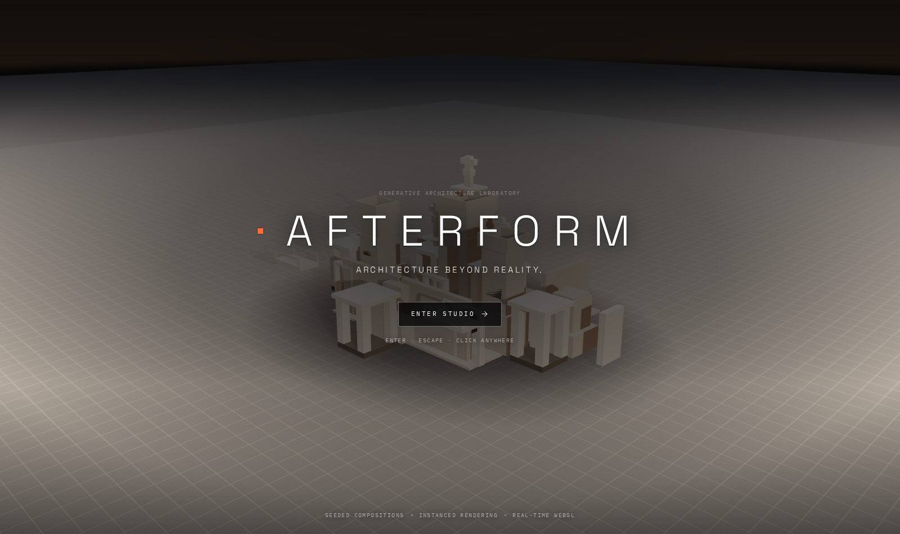

# AFTERFORM

**Architecture beyond reality.**

[](https://islomf2010-dot.github.io/afterform/)
[](https://github.com/islomf2010-dot/afterform)

An interactive generative architecture laboratory. Set the parameters, draw a seed, and the studio
composes an abstract architectural study out of concrete, glass and stone — then lets you take it
apart and rebuild it by hand.


| Night / Monolith | Day / Glass | Phone |
| ---------------- | ----------- | ----- |
|  |  |  |



---

## Run it

```bash
npm install
npm run dev        # http://127.0.0.1:5174
```

| Script                | What it does                                                     |
| --------------------- | ---------------------------------------------------------------- |
| `npm run dev`         | Vite dev server                                                   |
| `npm run build`       | Type check + production build into `dist/`                        |
| `npm run preview`     | Serve the production build on `:4174`                             |
| `npm run typecheck`   | `tsc -b` over app, tests and tooling                              |
| `npm test`            | Vitest — generator, project file, store                            |
| `npm run test:e2e`    | Playwright — studio flows, responsive shell, title sequence       |
| `npm run e2e:install` | Download the Chromium build Playwright needs                      |
| `npm run preview:svg` | Offline axonometric preview of generated compositions (see below) |
| `npm run audit`       | Render compositions in the real renderer and screenshot them      |
| `npm run perf`        | Count real draw calls while idle, orbiting and rebuilding         |
| `npm run verify`      | Screenshot the title sequence and the studio, collect console errors |

---

## The studio

**Title sequence** — on a first visit the studio renders the composition underneath and a title
card fades over it: `AFTERFORM`, the tagline, and `ENTER STUDIO`. `Enter`, `Escape`, `Space` or a
click anywhere dismisses it; `sessionStorage` remembers the choice for the rest of the tab session,
so it never appears twice in a row. The camera holds its own wider framing behind the wordmark and
glides into the studio's working view on entry — nothing behind the title moves, and nothing is
loaded on the way in.

**Top bar** — wordmark, composition name (editable, autosaves on blur), current seed, panel toggles,
`Generate`, `Reset`, `Export PNG`, `Save JSON`, `Load JSON`.

**Left panel** — `Select`, `Undo` / `Redo`, `Add block / column / slab / frame`, `Delete Selected`,
`Deselect`, element counter.

**Scene** — orbit, dolly and pan. Click an element to select it, drag it to move it on the ground
plane, `Shift`+drag to move it vertically. The selection is marked with a hairline box and a
footprint ring in the accent colour. After twelve seconds without any pointer or keyboard activity
the camera begins a very slow orbit and stops the moment you touch anything again — the composition
drifts while you are away and never while you are reading it. It is disabled entirely under
`prefers-reduced-motion`.

**Right panel** — the element inspector (position X/Y/Z, size W/H/D, kind) followed by
`Geometry`, `Materials`, `Lighting` and `Environment`.

**Bottom bar** — element count, active material, lighting mode, selection id, control hints.

### Keyboard

| Key                     | Action                              |
| ----------------------- | ----------------------------------- |
| `G`                     | Generate a new composition          |
| `R`                     | Reset to the default parameters     |
| `P`                     | Export PNG                          |
| `⌘/Ctrl + S`            | Save JSON                           |
| `⌘/Ctrl + O`            | Load JSON                           |
| `⌘/Ctrl + Z` / `⇧⌘Z`   | Undo / redo                         |
| `B` `C` `L` `M`         | Add block / column / slab / frame   |
| Arrows                  | Nudge the selection (hold `⇧` for a coarse step) |
| `PgUp` / `PgDn`         | Raise / lower the selection         |
| `Delete` / `Backspace`  | Delete the selection                |
| `Esc`                   | Deselect                            |
| `F`                     | Frame the composition               |
| `V`                     | Select tool                         |

Shortcuts are ignored while a text field has focus.

---

## How the generator thinks

`src/lib/generator.ts` is a pure function — no React, no Three.js, fully unit tested.

1. **Site plan.** A weighted sample picks the cells of the canonical quadrant from a grid of
   `CELL = 2` modules. The number of masses comes from the object budget, so a composition always
   finishes inside it instead of being cut in half. Occupancy thins towards the edge of the site and
   immediate neighbours are sometimes rejected, which keeps the plan from clumping.
2. **Heights.** Every cell gets a storey count from its distance to the centre, so the silhouette
   falls off from a single dominant mass. One cell is promoted to hero and capped.
3. **Towers.** Five archetypes — stacked massing with belt slabs, a colonnade pavilion, a cantilever
   stack, a stepped terrace, and a **void tower**: two piers carrying a lintel and a cantilevered
   upper volume. The hero cell prefers the void tower, because four masses around a hole read as a
   building where a single tall stack reads as a chimney. Proportion (slender / square / wide) is
   tied to height so a tall stack never becomes a needle, and the set-backs are frequent enough that
   the profile clearly steps.
4. **Articulation.** The difference between a box and a building: recessed reveal bands cut into the
   facades of the upper storeys, roof parapets that close the plate instead of leaving a bare
   rectangle, belt slabs, bridge railings, and a tapered crown with a service platform and a
   cross-head in place of a bare mast.
5. **Landmarks.** Three gestures that read at a glance, emitted in order of importance so a tight
   budget loses its figures before it loses its arch: a **voussoir arch** (two piers and seven
   rotated blocks — the only curved element in the vocabulary, and the reason elements carry an
   optional rotation), stairs up onto the podium, and **human-scale figures** standing on the plate.
   A 1.75-unit figure beside a fourteen-unit tower is what tells the eye how big the architecture is.
6. **Site furniture.** A low enclosing wall scaled to the massing height, bridges between adjacent
   towers with railings, portal frames on the free faces of the plan, and a long gate across the
   courtyard when the plan is symmetric enough to have one.
7. **Mirroring.** Only the canonical quadrant is built; everything else is a true reflection of it.
   Towers, walls, bridges, frames, arches, stairs and figures are emitted as whole mirrored groups —
   half a reflection reads as damage, so if the budget cannot fit a group the group is skipped.

**Budget order.** Every stage reserves what the stages after it will need (site, towers, enclosure,
bridges, gateways, landmarks). Without that reservation the towers quietly swallow the whole budget
and the composition silently loses exactly the detail that makes it read as architecture.

**Material families.** Each element is tagged `base`, `mass` or `accent`, and each preset defines
three tones for them. A dark family for openings and plinths, a mid family for the masses, a bright
family for frames, arches and crowns — that value hierarchy is what gives the image depth, where a
single material reads as a grey blob. It is three instanced meshes, not one, and still nothing.

Determinism comes from `mulberry32` seeded through an xmur3 string hash. The same seed and the same
parameters always produce the same composition, element for element, ids included.

**Random Seed** in the Geometry panel rebuilds from any seed you type; `Generate` draws a new one.

### Previewing compositions without a browser

```bash
npm run preview:svg -- CLOISTER 1     # one composition
npm run preview:svg -- contact 9 AB   # a contact sheet of nine
npm run preview:svg -- sweep          # every parameter corner, with warnings
```

The script renders compositions with a painter's algorithm axonometric projection into
`.shots/*.svg`, shaded by material family. It is how the massing was tuned — fast to iterate on, and
it catches degenerate output (thin compositions, missing frames, budget overflow) before anything
reaches WebGL. `npm run audit` then renders the same seeds through the real renderer, so the two
together judge the composition and the picture.

---

## Architecture

```
src/
  lib/            pure domain logic — no React, no Three.js
    generator.ts    procedural architecture
    parts.ts        element -> box parts (the instancing source of truth)
    presets.ts      material / lighting / quality definitions
    projectFile.ts  JSON validation + serialisation
    rng.ts          seeded randomness
  store/          three focused zustand stores
    sceneStore.ts   composition, selection, undo history
    lookStore.ts    material, lighting, environment
    uiStore.ts      tool, panels, toasts, scene-ready flag
  three/          rendering, one concern per rig
    SceneCanvas          canvas + WebGL fallback
    ArchitectureScene    composition of the scene
    StructureField       instanced elements per material family, picking, dragging
    LightingRig          key / fill / rim / accent, one shadow caster
    SkyDome              gradient backdrop, one shader, one draw call
    ContactShadowRig     the pool of shade under the composition
    EnvironmentRig       procedural lightformer cube map
    GroundRig            plate + survey grid
    AtmosphereRig        interpolated fog, exposure, environment intensity
    CameraRig            orbit controls, framing transitions, idle drift
    SelectionMarker      accent wireframe + footprint ring
    ExportBridge         PNG capture at export resolution
  components/     interface
  hooks/          hotkeys, media queries
  tests/          vitest
e2e/              playwright
scripts/          offline preview + verification tools
```

The stores are split on purpose: dragging the accent colour slider re-renders one small control and
one light, not the composition. `three/` components subscribe with selectors rather than contexts.

---

## Performance

Target hardware is a Surface Laptop 4 with integrated graphics.

- **One draw call per material family.** Every element is a box, so the composition is one
  `InstancedMesh` per tone — three in total, not one per element. Picking works off `instanceId`
  into the group's slice of a tone-ordered part list, so selection and rendering agree by
  construction. Transparent presets add one merged `LineSegments` per family for the edge overlay.
- **`frameloop="demand"`.** The renderer only draws when something changes. Idle costs **0 draw
  calls** — measured, not assumed (`npm run perf`). The idle drift is deliberately driven from a
  timer rather than the frame loop: a callback that only runs while rendering can never *start* the
  animation it is waiting for.
- **Bounded work per rebuild.** Matrices are recomputed for a full rebuild and left alone otherwise;
  entrance animation stops as soon as every element has arrived; the atmosphere interpolation stops
  when it reaches its target.
- **One shadow map**, PCF at 2048 (1024 in lite), sized to the composition bounds. The contact pool
  under the model is a single transparent quad with a generated radial texture, not an AO pass.
- **Atmosphere for one draw call.** The backdrop is a gradient dome with a three-colour shader — no
  post-processing stack, no render targets, no extra passes on integrated graphics.
- **Pixel ratio capped** at 1.6, dropped to 1 in lite mode.
- **Environment without downloads.** A 128px cube map baked from lightformers — no HDR fetch, works
  offline, re-baked only when the lighting mode changes.
- **Lite mode** for weaker machines: 96 elements, pixel ratio 1, 32px environment, smaller grid.
  The budget applies to compositions generated from then on — switching never discards work.
- **Budgets before features.** Every generator stage reserves what the next stages need, so the
  enclosure, bridges, gateways and landmarks never get squeezed out at high complexity.

### Export

`Export PNG` renders one frame at 2× the current canvas size (capped at 4096px) straight to a data
URL, then restores the renderer. `preserveDrawingBuffer` stays off, so nothing is paid for on frames
nobody exports. Failures (lost context, empty buffer) surface as an error toast instead of a silent
no-op.

`Save JSON` writes the composition plus the full look. `Load JSON` validates the structure: wrong
format or version is rejected outright, malformed elements are dropped with a count, out-of-range
numbers are clamped, duplicate ids are renamed, and oversized files are truncated — with the reason
reported in the toast.

---

## Accessibility and responsiveness

- Native controls throughout: range inputs, number inputs, `role="group"` segmented controls,
  `aria-pressed` state, visible `:focus-visible` outlines in the accent colour.
- Every control has an accessible name; the end-to-end suite fails if one ever loses it.
- A polite live region announces the selection and composition state.
- `prefers-reduced-motion` disables the entrance animation, the selection pulse, the camera glide and
  the idle drift — the camera snaps instead.
- The title sequence is a labelled dialog: it announces itself, takes focus, and every key that would
  otherwise reach the studio is swallowed until it is dismissed.
- Desktop gets the full editor, tablet narrower panels, phones a single bottom sheet with the panel
  toggles moved into the bottom bar. The scene never collapses, and no layout scrolls sideways.
- Without WebGL the studio shows an explanation and keeps the composition data intact.

---

## Testing

```bash
npm test           # 40 unit tests: determinism, budgets, symmetry, articulation, validation, store
npm run test:e2e   # 39 end-to-end tests across desktop, mobile and title projects
npm run perf       # production build: real draw calls while idle, orbiting, rebuilding
npm run verify     # production build: console errors and screenshots
```

The end-to-end suite covers boot without console errors, seed reproducibility, select/move/nudge/
delete, undo/redo, that every material and lighting mode renders a *different* image, live
parameter editing, PNG export (downloaded bytes checked), JSON round trip, rejection of a malformed
file, keyboard shortcuts, control labelling, five viewport sizes, reduced motion and the WebGL
fallback.

The title sequence has its own project and its own coverage: entering on `Enter`, on `Escape` and on
a click anywhere, staying dismissed for the rest of the session, swallowing studio shortcuts while it
is up, holding the composition perfectly still behind the wordmark, and animating nothing under
reduced motion.

The camera behaviour is tested by observation rather than configuration: a still composition must
issue no draw calls, a drag must produce frames, and after the idle delay the pixels must actually
change. Screenshots are compared **pixel by pixel after decoding**, never as PNG bytes — the same
image re-encoded differs in almost every byte, and a byte comparison there would be meaningless.

> The suite runs under swiftshader, where one composition takes tens of seconds to build. The
> per-test budget is set well above what a real GPU needs for that reason; raising it is correct, and
> timeouts on a loaded machine are not a regression signal.

---

## Notes

- `@react-three/fiber` 9.8.1 still constructs a `THREE.Clock`, which three 0.186 deprecates. It is a
  one-line warning from inside the library and is not suppressible from application code; it will
  disappear when R3F moves to `THREE.Timer`.
- Parameter sliders rebuild the composition live against the current seed. Those previews are not
  undo steps — otherwise a single slider drag would flood the history. `Generate` and every manual
  edit are.
- Nothing in the app calls an external service. Fonts are bundled, the environment map is generated,
  and compositions live in memory and in files the user downloads.